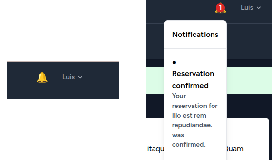

# Reservation Platform

A reservation management platform built with **Laravel 13** and **PHP 8.3**.

The goal of this project is to demonstrate backend development practices using Laravel, focusing on business rules, database consistency, clean code, testing, API design and performance optimization.

The application allows users to browse events, reserve seats, and manage their reservations.

---

# Overview

The main domain concepts are:

- Users
- Events
- Reservations

The project was designed to demonstrate real-world backend concerns:

- Authentication
- Business rules and database consistency
- Query optimization
- Automated testing
- REST API
- Jobs and queues
- User notifications

---

# Features

## Implemented

### Authentication

Implemented using Laravel Breeze.

Features:

- User registration
- Login
- Logout
- Profile management

### Event Management

Users can:

- Browse available events
- View event details
- See available seats
- Check reservation status

### Reservation Flow

Users can:

- Reserve an event
- View their reservations
- Prevent duplicate reservations

Business rules:

- A user cannot reserve the same event twice.
- Users cannot reserve events without available seats.
- Seat availability is updated together with reservation creation.

### Asynchronous Notifications

Reservation confirmation notifications are processed asynchronously using Laravel Jobs and Queues.

The notification flow is presented in a Vue.js notification component that provides:

- Unread notification badge
- Lightweight polling for unread notifications
- Loading state
- Mark notifications as read
- Reactive unread counter

#### Notification Center



---

# Tech Stack

## Backend

- PHP 8.3
- Laravel 13
- Eloquent ORM
- Docker Compose
- Breeze
- Blade
- Paginação
- Tratamento de N+1 (withExists())

## Database

- PostgreSQL

## Frontend

- Blade Templates
- Laravel Breeze
- Tailwind CSS
- Vue

## Development

- Docker
- Composer
- Vite

---

# Architecture

The application follows Laravel conventions with separation between controllers, models and business logic.

Current structure:

```
app/

├── Http/
│   ├── Controllers/
│   └── Resources/
│
├── Jobs/
│   └── ReservationCreatedJob.php
│
├── Models/
│
├── Services/
│   └── ReservationService.php
│
└── Exceptions/
    ├── NoSeatsAvailableException.php
    └── AlreadyReservedException.php
```

---

## Database Model

Main relationships:

User 1:N Reservation
Event 1:N Reservation

- A user can have many reservations.
- A reservation belongs to a user and an event.
- An event can have many reservations.

## Event

An event contains:

- Name
- Description
- Date
- Total seats
- Available seats

## Reservation

A reservation belongs to:

- User
- Event

---

# Business Rules

## Duplicate Reservation Prevention

A user cannot reserve the same event more than once.

## Seat Availability

Reservations validate available capacity before creating a reservation.

# Database Transactions

Reservation creation and seat decrement are executed inside the same database transaction, ensuring both operations succeed or are rolled back together.

---

# Query Optimization

During development, Laravel Debugbar was used to analyze database queries.

An N+1 query problem was identified in the event listing.

Before:

```
Load events

+

Check reservation status individually
for each event
```

After:

```
Load events

+

Load reservation status
using withExists()
```

This reduces unnecessary database queries and keeps the view layer focused on presentation.

---

## Pagination

Event listing uses Laravel pagination with `paginate(10)` to avoid loading all records at once.

---

# Testing

The project uses **Pest** for automated testing.

Implemented coverage includes:

- Authentication flows
- Public event listing API
- Reservation API endpoints
- Protected API endpoints
- Reservation business rules
- Database consistency
- ReservationCreatedJob
- Queue dispatch verification using Queue::fake()
- Notification creation
- Notification endpoints
- Notification authorization

The tests use:

- SQLite in-memory database
- RefreshDatabase
- Feature tests
- Service layer tests

Run the test suite:

```bash
php artisan test
```

---

# REST API

The API exposes the reservation domain through Laravel Sanctum.

Available endpoints:

| Method | Endpoint                           | Description              |
| ------ | ---------------------------------- | ------------------------ |
| POST   | `/api/login`                       | Authenticate user        |
| GET    | `/api/events`                      | List events              |
| POST   | `/api/events/{event}/reservations` | Create reservation       |
| GET    | `/api/my-reservations`             | List user's reservations |

---

# Redis / Queues

```
Reservation
    ↓
Database Transaction
    ↓
Reservation + Seat Update
    ↓
Commit
    ↓
afterCommit() → Dispatch Job
    ↓
Redis Queue
    ↓
Laravel Worker
    ↓
ReservationCreatedJob
    ↓
Notification
```

---

# Local Development

## Requirements

- PHP 8.3+
- Composer
- Node.js / npm
- Docker

# Docker Environment

The project uses Docker Compose for PostgreSQL and Redis, while Laravel runs locally using Artisan.

## Installation

Clone repository:

```bash
git clone <repository-url>
```

Install dependencies:

```bash
composer install
```

Configure environment:

```bash
cp .env.example .env
```

Generate application key:

```bash
php artisan key:generate
```

## Start database

Start PostgreSQL container:

```bash
docker compose up -d
```

## Run migrations & Seed

```bash
php artisan migrate
```

```bash
php artisan db:seed
```

## Start development server:

```bash
php artisan serve
```

## Queue Worker

The application uses Redis as the queue backend.

Start the queue worker:

```bash
php artisan queue:work redis
```

## Frontend Development

```bash
npm install
npm run dev
```

## Demo Data

The project includes seed data for development.

Run:

php artisan db:seed

This creates sample events to demonstrate:

- Event listing
- Pagination
- Reservation flow

## Access Web Application

```bash
http://localhost:8000/events
```

---

# Author

Backend developer focused on PHP/Laravel and Go.

This project was created as a portfolio application to demonstrate backend engineering practices with Laravel.
